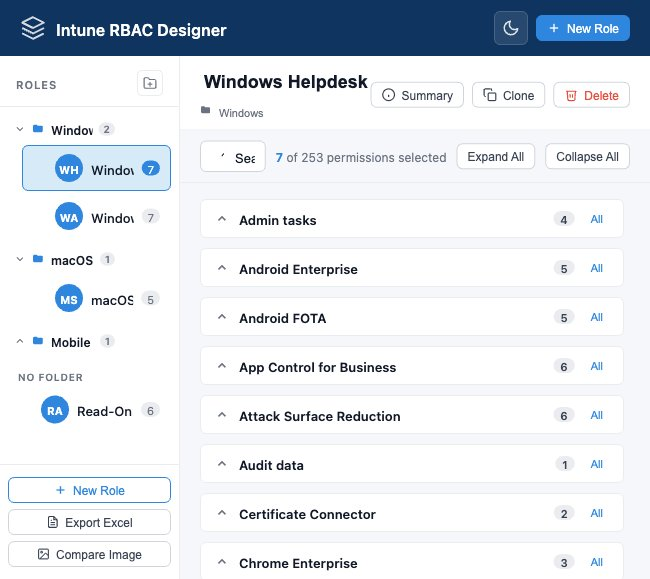
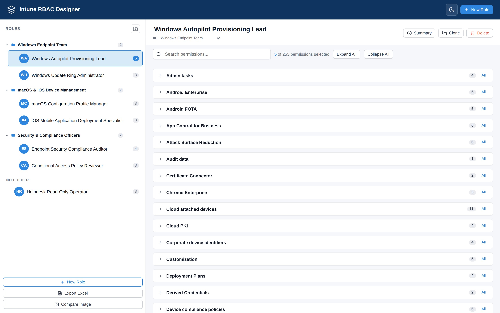
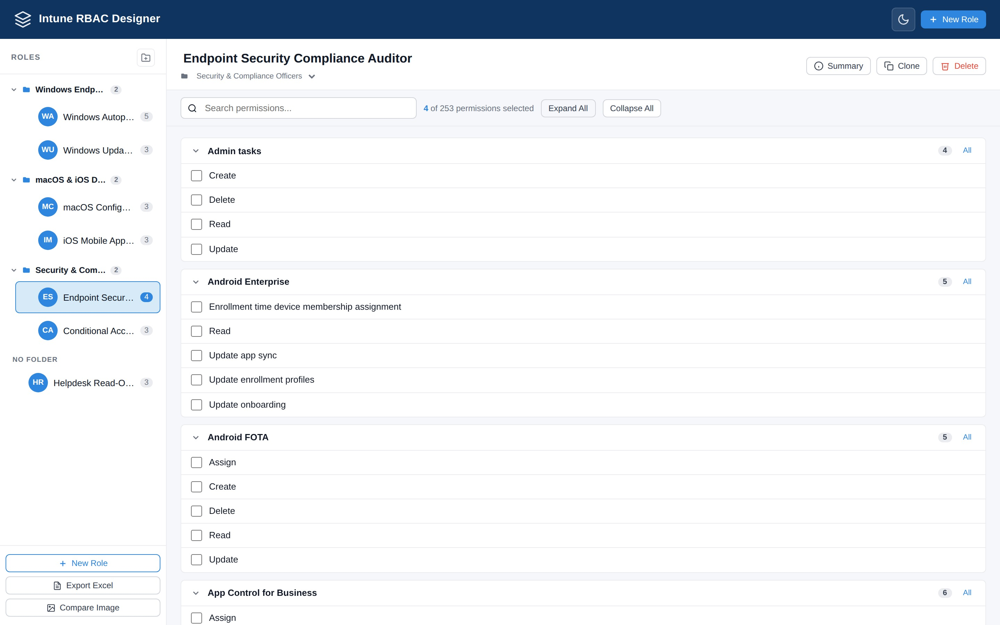
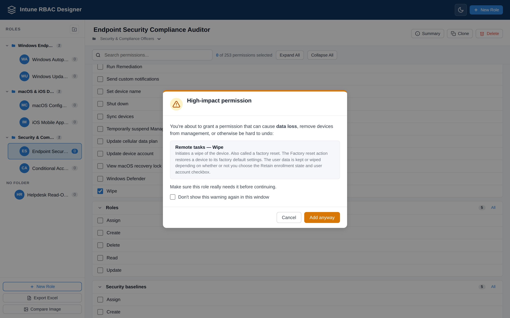
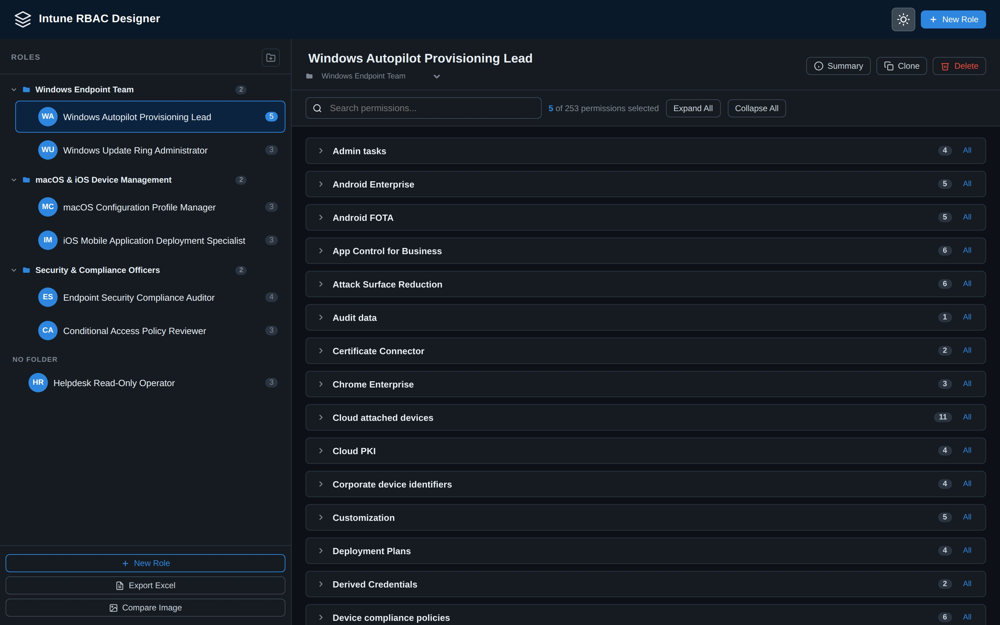

# Intune RBAC Designer

A local, zero-install app for designing Microsoft Intune custom RBAC roles. Run the Windows exe, or open `index.html` in any browser — no server, no installer, no accounts.

Built for Intune admins who need to think through role permissions before committing them in the portal, share designs with teammates, or document what each role actually does.

## Download for Windows

1. Go to the [latest release](https://github.com/Michael-Civitillo/intune-rbac-designer/releases/latest) and download **Intune-RBAC-Designer-…-win-x64.exe**.
2. Double-click it. That's it — nothing is installed and you don't need admin rights.

Good to know:

- **Starting takes 10–15 seconds.** The exe is a single portable file that unpacks itself each time it starts; a small "Starting…" window shows while it does.
- **Windows may warn you.** The app isn't code signed, so SmartScreen can show "Windows protected your PC". Choose **More info**, then **Run anyway**. Some organizations block unsigned apps entirely; if yours does, use the browser version below.
- **Your work is kept.** Roles are saved on your PC (under `%APPDATA%\Intune RBAC Designer`) and are there the next time you open the app, even if you move or re-download the exe.
- **Exports go to Downloads**, and the file is highlighted in Explorer when it's ready.
- **It stays offline.** The app makes no network connections.
- Windows 10 or 11, 64-bit.

---



---

## What it does

**Design roles visually** — Browse all 53 Intune permission categories (pulled from Microsoft Learn), check off the exact permissions each role needs, and see a live count as you go.

**Organize with folders** — Group roles by team (Windows, macOS, Mobile, Security, etc.). Drag roles between folders or drop them into "No Folder" to reorganize on the fly. Hover a folder to add a role to it, rename it, or delete it.

**Descriptions right in the list** — Every permission shows Microsoft's description under its name, and clicking anywhere on a row ticks it. Long descriptions fold to three lines with a **Show more**. Prefer a denser list? Switch **Descriptions** off and hover a permission to read its description in a tooltip instead.

**Search and filter** — Search matches permission names, descriptions and category names, highlights what it found, and opens the matching categories for you. Press `/` to jump to the search box and `Esc` to clear it. Switch from **All** to **Selected** to review just what a role grants.

**Role summary** — Hit **Summary** on any role to get a quick overview: how many permissions are selected, how many categories they span, how many are high impact, and a full breakdown.

**Clone roles** — Duplicate an existing role as a starting point instead of building from scratch.

**Undo instead of "Are you sure?"** — Deleting a role or folder happens straight away, with an **Undo** button in the notification that puts it back exactly where it was.

**Export to Excel** — One workbook, one sheet per role, plus a summary sheet. Selected permissions are highlighted green. Ready to share with your team or attach to a change request.

**Export comparison image** — Generate a side-by-side PNG of all roles showing which permissions each one has selected. Useful for reviews and documentation.

**Resizable sidebar** — Drag the right edge of the sidebar to make the role column wider or narrower. Long role names and folder names display in full at whatever width you choose. The width is remembered between sessions; double-click the edge to reset it.

**High-impact permission guardrail** — Permissions like *Wipe*, *Retire*, *Reset passcode*, *Delete* on managed devices, and both Remote Help *unattended control* permissions carry a **High impact** badge. When you grant one, the app asks you to confirm before it's added. If you're sure you want to keep moving fast, tick "Don't show this warning again in this window" and the prompt is suppressed for the rest of the session.

**Dark mode** — Follows your system preference and can be toggled manually.

**Keyboard and small screens** — Roles, folders, categories and checkboxes are all reachable from the keyboard. On a narrow window the role list tucks into a slide-out panel.

**Persists locally** — Everything saves to `localStorage` automatically. Your roles are there next time you open the file.

---

## Screenshots

### Resizable sidebar — drag to reveal full role and folder names


### Permission picker with folder structure


### Confirmation prompt for high-impact permissions


### Dark mode


---

## Getting started

1. Start the app — the [Windows exe](#download-for-windows), or clone/download this repo and open `index.html` in Chrome, Edge, or Safari
2. Click **New Role** to create your first role
3. Use the folder icon in the sidebar to create team folders
4. When you're ready — export to Excel or grab a comparison image

That's it. No `npm install`, no config, no accounts.

---

## How it works

Everything is vanilla HTML, CSS, and JavaScript. No frameworks, no build pipeline.

| File | What it does |
|---|---|
| `index.html` | App shell and layout |
| `styles.css` | Full token-based theming (light + dark) |
| `app.js` | All app logic — state, rendering, drag-and-drop |
| `permissions.js` | All 53 Intune permission categories and descriptions |
| `export-excel.js` | Excel export via SheetJS |
| `export-image.js` | Comparison PNG via html2canvas |
| `vendor/` | SheetJS and html2canvas, bundled so everything works offline |
| `desktop/main.js` | The Windows app's shell: a window around the same page |

The only dependencies are SheetJS and html2canvas. Both are checked in under `vendor/` (versions, licenses and checksums are in `vendor/README.md`), so nothing is loaded from a CDN and exports work offline.

---

## Building the Windows app

The exe is the same page wrapped in [Electron](https://www.electronjs.org/). You don't need to build it yourself: GitHub Actions does it on every push (`.github/workflows/windows-app.yml`), tests the result on a real Windows machine, and attaches the exe to the run under **Artifacts**.

**To publish a release**, push a version tag. The build takes its version number from the tag and the exe is attached to a new GitHub release:

```
git tag v1.0.0
git push origin v1.0.0
```

To build locally on Windows instead (Node.js 22 or newer):

```
npm ci
npm run dist        # writes dist/Intune-RBAC-Designer-<version>-win-x64.exe
npm start           # or just run the app without packaging it
```

The exe is unsigned. To remove the SmartScreen warning it needs a code-signing certificate, which electron-builder can use once you have one.

---

## Permissions data

The `permissions.js` file contains all Intune custom role permission scopes pulled directly from the Microsoft Learn documentation. Categories include Device Management, Mobile Apps, Managed Devices, Endpoint Security, Policy Sets, and 48 others.

**Last synced with Microsoft Learn: November 2026** (Intune service release 2611) — 255 permissions across 53 categories. Changes picked up in that sync:

- **Android Enterprise** — new *Manage zero touch enrollment* permission (2607). Access to the Google zero-touch portal no longer needs *Update app sync*.
- **Android Enterprise** — *Enrollment time device membership assignment* is now *Enrollment time device membership assignment for Android Enterprise*.
- **Remote Help app** — new *Windows unattended control remote sign-in* permission (2608).
- **Remote Help app** — *Unattended control* is now *Android unattended control*.

Permission names and descriptions are Microsoft's wording, so what you see here is what you'll look for in the Intune admin center. That includes a few quirks in *Remote tasks*, such as the trailing period on *Sync devices.* and *Get FileVault key.*

If Microsoft adds new permissions in a future update, edit `permissions.js` to add them — the rest of the app picks them up automatically. If Microsoft renames one, add it to `PERMISSION_RENAMES` at the bottom of the same file: roles saved under the old name are carried over to the new one the next time the app loads.

---

## Local storage

Roles and folders are saved to `localStorage` under the key `intuneRbacRoles`. If you want to back up your work or move it to another machine, open DevTools → Application → Local Storage, copy the value, and paste it on the other machine. (In the Windows app, press Alt to show the menu, then **View → Toggle Developer Tools**.)

The Windows app and the browser version each keep their own copy; they don't share roles.

Data format is versioned — the app handles migrating from older saves automatically.

---

## License

Released under the [MIT License](LICENSE) © Michael Civitillo.
